<div align="center">

# GrowthLab
### Customer Behaviour, Retention & Experimentation Analytics

**From product-event data to customer insights, retention measurement, and evidence-based experimentation**


**7.80M cleaned events** &nbsp; · &nbsp; **725.7K active users** &nbsp; · &nbsp; **3 Tableau dashboards**

[Explore the dashboards](#tableau-dashboards) · [Review findings](#analytical-findings) · [Inspect the architecture](#solution-architecture) · [Reproduce the analysis](#reproducibility)

</div>

---

## Executive summary

**GrowthLab** is an end-to-end e-commerce customer analytics solution built with **Python, DuckDB, SQL, and Tableau**. It transforms December 2019–January 2020 cosmetics-store event logs into auditable business metrics, customer-behaviour analyses, and interactive reporting.

The analysis examines product interactions, session-stage funnels, purchaser retention, RFM segments, recorded purchase-value trends, and the limitations created by incomplete product classification.

A **separate, explicitly synthetic A/B experiment** explores how a randomized checkout test would be evaluated using conversion rates, a two-proportion z-test, and confidence intervals. Its results are **not** observations from the retailer's historical event data.

### At a glance

| Measure | Observed result | Interpretation |
|:--|--:|:--|
| Cleaned product-event records | **7,797,981** | Events retained after defined validation rules |
| Active users | **725,736** | Distinct observed user IDs |
| Purchasing users | **49,861** | Distinct users with at least one purchase event |
| Purchase-item events | **476,919** | Product purchase events, **not unique orders** |
| Recorded purchase value | **2,400,858.75** | Sum of purchase-event prices; currency unverified |
| Dec → Jan purchaser retention | **15.51%** | 3,972 of 25,613 first-observed December purchasers returned in January |
| Tableau dashboards | **3** | Executive, Customer Behaviour, Experimentation |

> **Reading the results:** Event-level purchase records cannot be treated as verified orders. Prices are reported in source units, not an assumed currency. Session funnel stages represent events appearing together in a session, not proof of a chronological sequence.

---

## Tableau dashboards

The [**packaged Tableau workbook**](tableau/GrowthLab_Analytics_Final.twbx) contains three interactive dashboards and eight aggregated data extracts. The workbook was created in **Tableau Desktop Public 26.3.2162** and packages the aggregate extracts used by its views. The five screenshot previews below show the finished dashboards and two detailed analytical worksheets.

| Dashboard | Questions addressed | Main visuals |
|:--|:--|:--|
| **Executive Overview** | How much activity and recorded purchase value occurred? | KPIs, daily purchase trend, labeled categories |
| **Customer Behaviour** | How do session stages and purchaser retention compare? | Funnel, retention heatmap, RFM segments |
| **Experimentation Analytics** | How should simulated conversion differences be evaluated? | A/B bars, uplift, test evidence |

### 01 · Executive Overview

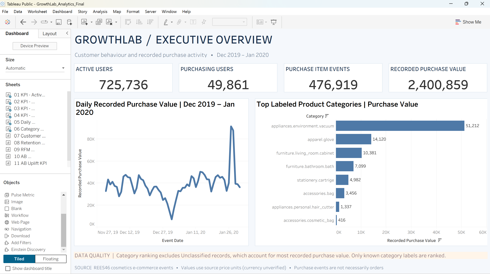

*Executive dashboard — active and purchasing users, purchase-item events, recorded purchase value, daily trends, and labeled-category performance.*

The executive layer combines unique active and purchasing users, item-level purchase events, and recorded purchase value with a daily activity trend. Product-category reporting explicitly separates labeled and unlabeled transactions.

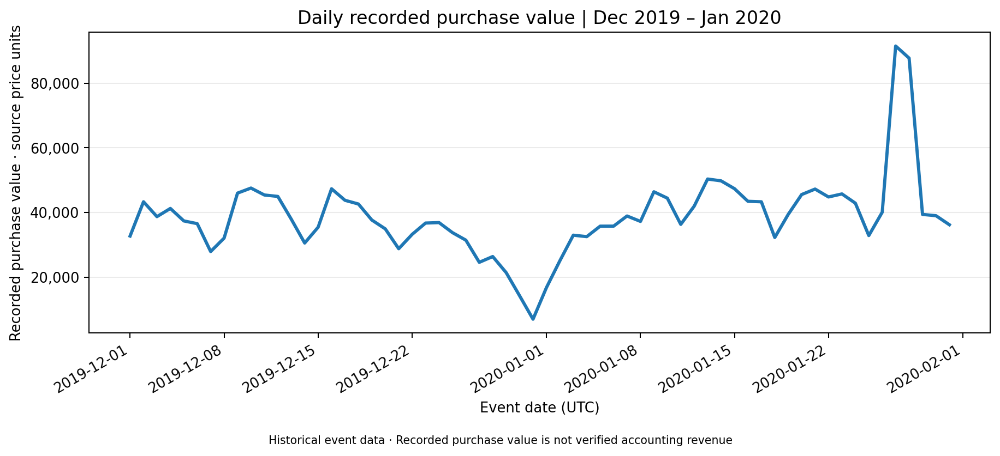

<details>
<summary><b>See the category performance view and classification caveat</b></summary>

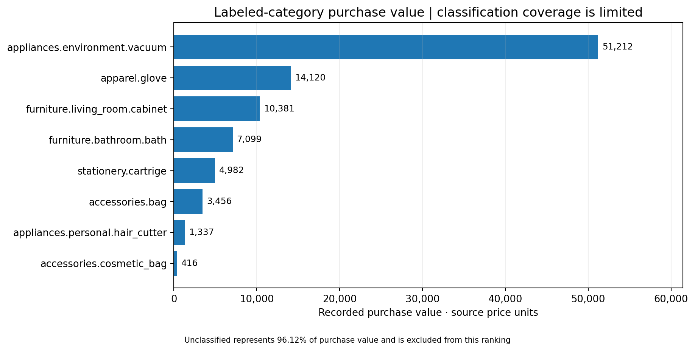

**Coverage caution:** `Unclassified` accounts for **96.12%** of recorded purchase value. The chart ranks **only labeled categories**, so it does not represent the full assortment.

[View the original Tableau category worksheet screenshot](assets/screenshots/13_tableau_executive_charts.png).

</details>

### 02 · Customer Behaviour

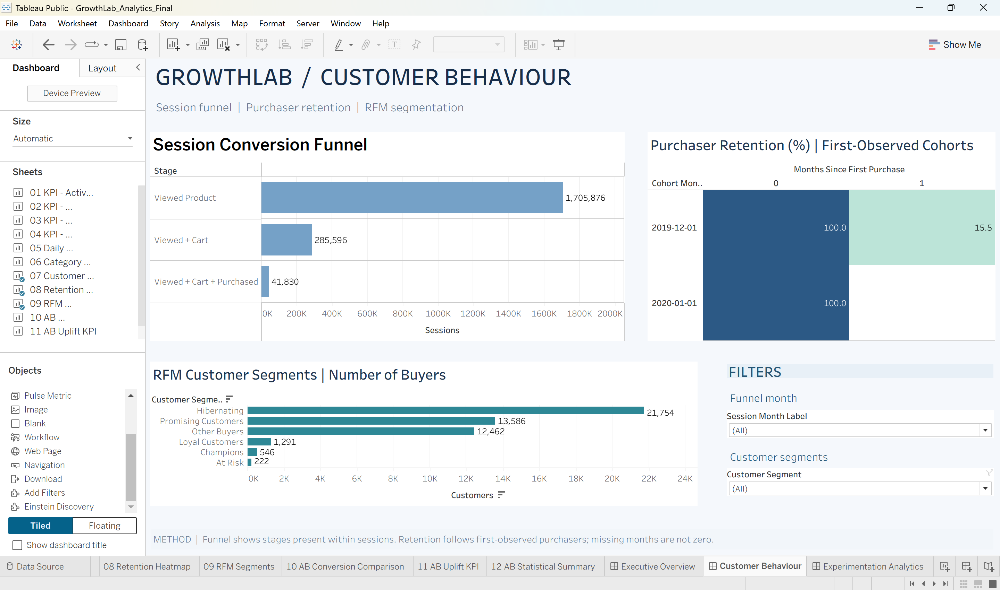

*Customer Behaviour dashboard — session-stage funnel, purchaser-retention cohorts, and RFM customer segments in one interactive view.*

**Session funnel:** the three nested stages measure whether a session contains a view, view + cart, or view + cart + purchase; stage presence does **not** establish chronological conversion.

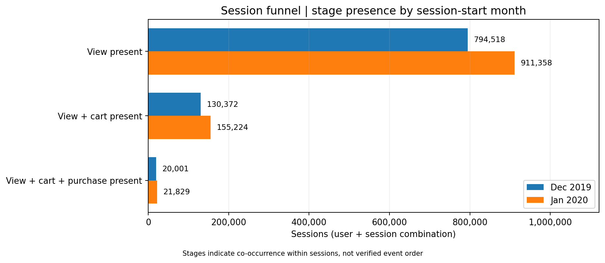

**Purchaser retention:** customers are assigned to their first **observed** purchase month within the two-month dataset. December's following-month retention is measurable; January's following-month retention is **not observed**.

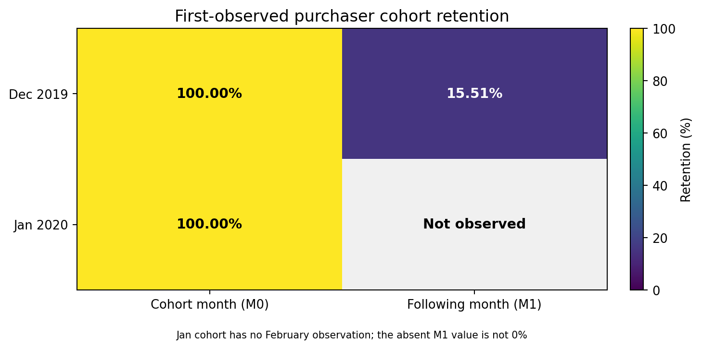

<details>
<summary><b>View the Tableau purchaser-retention heatmap</b></summary>

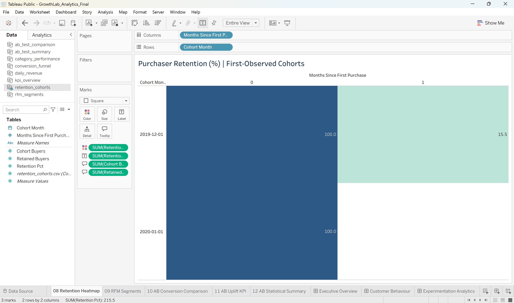

*December's first observed purchaser cohort has a measurable January return rate. January's following-month outcome falls outside the source data window and is not interpreted as zero.*

</details>

**Customer segmentation:** RFM groups summarize recent and recurring purchasing behaviour, with purchase-session frequency and recorded purchase-value scoring.

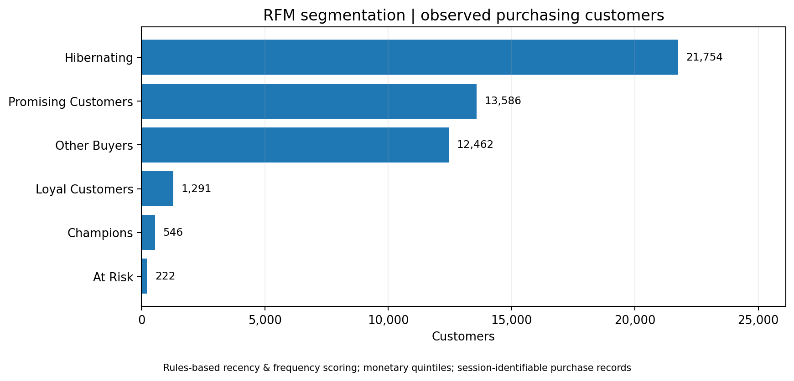

<details>
<summary><b>View the Tableau RFM segmentation worksheet</b></summary>

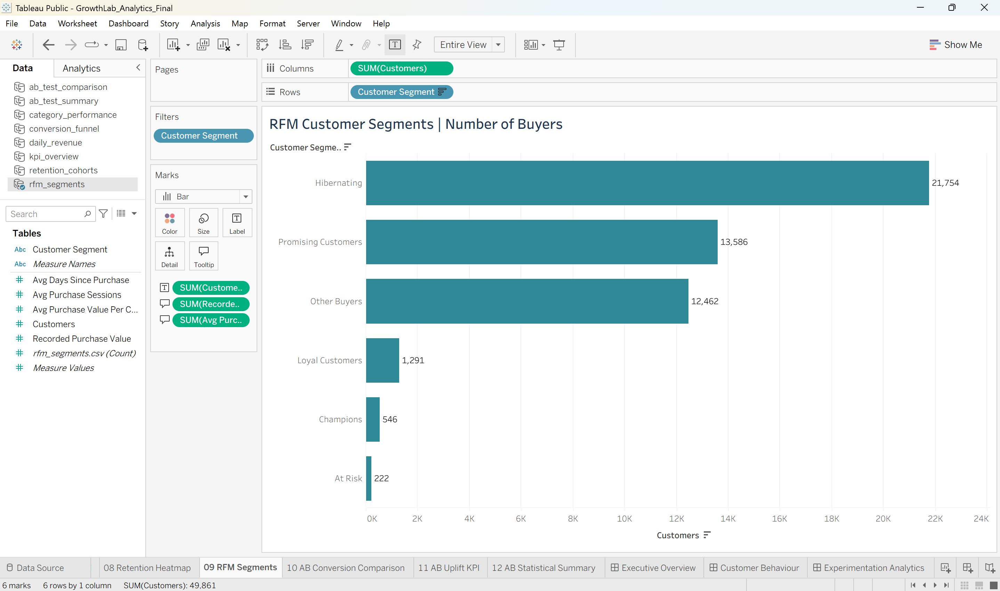

*RFM segment sizes are descriptive groupings based on purchase recency, purchase-session frequency, and recorded monetary value.*

</details>

### 03 · Experimentation Analytics (synthetic)

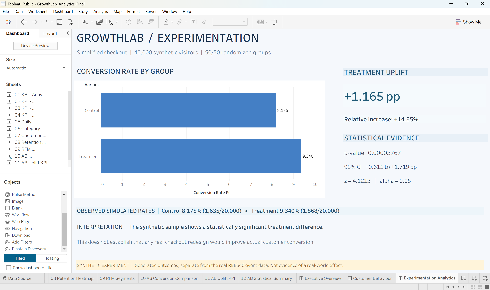

*Experimentation dashboard — simulated Control and Treatment conversion comparison, uplift, statistical test results, and uncertainty.*

The experimentation dashboard analyzes a **separately generated randomized simulation** of 40,000 visitors split equally between Control and Treatment. The experiment uses simulated data, while the hypothesis test, uncertainty estimation, and interpretation are implemented with reproducible code.

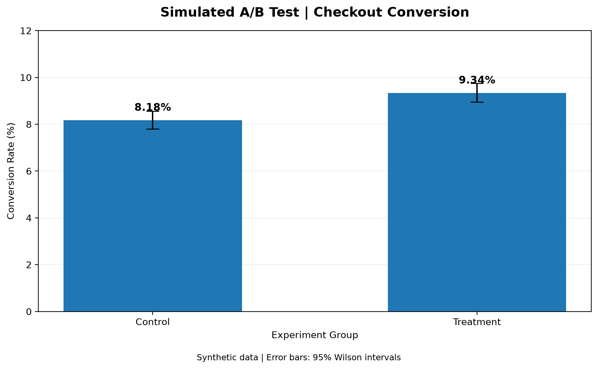

| Simulated experiment metric | Result |
|:--|--:|
| Control conversions | 1,635 / 20,000 (**8.175%**) |
| Treatment conversions | 1,868 / 20,000 (**9.340%**) |
| Absolute difference | **+1.165 percentage points** |
| Relative difference | **+14.25%** |
| Two-sided two-proportion z-statistic | **4.1213** |
| *p*-value | **0.00003767** |
| 95% CI, Treatment − Control | **+0.611 to +1.719 pp** |

Under the simulation assumptions, the Treatment difference is statistically significant at α = 0.05. **This does not establish any actual checkout redesign effect**: the historical data contains no treatment allocation, and no real checkout was evaluated.

---

## Analytical findings

### 1 · Purchasing participation is lower than overall activity

**49,861 of 725,736 observed active users (6.87%)** have at least one purchase event during the analysis window. This is an *observed purchaser share*, not a website-wide conversion rate: event logs, tracking coverage, and denominator definitions differ from a controlled web experiment.

### 2 · January recorded purchase value exceeds December

Recorded purchase value totals **1,078,164.53** for December and **1,322,694.22** for January (source price units). The largest observed daily values occur on **January 27–28**. These patterns warrant deeper contextual analysis; they do not, by themselves, identify a cause.

### 3 · Cart-stage presence varies slightly by month

Of sessions containing views, **16.41% in December** and **17.03% in January** also contained cart events. Sessions containing all three funnel events represented **2.52%** and **2.40%** of viewed sessions, respectively. The measure is session-stage co-occurrence, not verified step-by-step conversion.

### 4 · Short-term purchaser retention is measurable but limited

Of the **25,613** users whose first observed purchase month was December, **3,972** also purchased in January, producing **15.51%** following-month retention. January's following-month outcome is unavailable; its absent value must not be treated as 0%.

### 5 · Product-category coverage is the primary reporting limitation

`Unclassified` accounts for **2,307,732.62 of 2,400,858.75** recorded purchase-value units (**96.12%**). Rankings among labeled categories therefore represent only a small classified share. The correct next analytical priority is to improve product classification before drawing category-mix conclusions.

### 6 · RFM groups provide differentiated customer views

The rules-based RFM analysis groups purchasing users into segments such as Hibernating, Promising Customers, Loyal Customers, Champions, and At Risk. These **descriptive groupings** can guide follow-up analysis, but they are not a validated prediction of customer lifetime value or response to marketing.

---

## Business questions and metric design

| Question | Approach |
|:--|:--|
| Which KPIs describe customer and purchase activity? | Distinct users, purchase events, recorded purchase value |
| How many sessions contain key shopping events? | Session flags grouped by `user_id` and `user_session` |
| Which observed buyers returned? | First-observed purchaser-month cohort and month offset |
| Which purchasing customers show similar patterns? | RFM recency, distinct purchase sessions, monetary quintiles |
| How did recorded purchase value change by day? | Daily aggregations of purchase-event prices |
| Which categories contribute purchase value? | Aggregation by category code, with unclassified coverage disclosed |
| Does a simulated treatment differ from control? | Random assignment, conversion estimates, z-test, 95% CI |

---

## Solution architecture

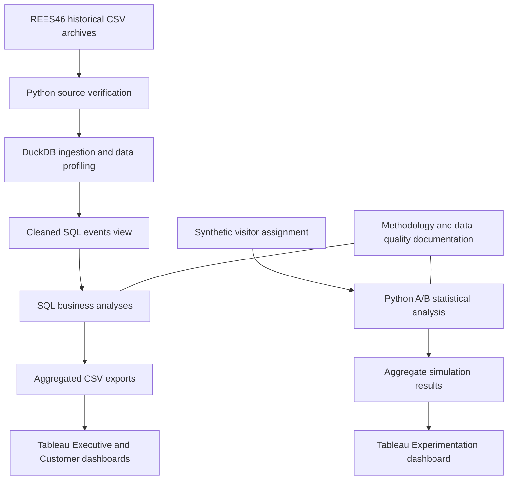

**Privacy boundary:** The original row-level event archives and local DuckDB database stay outside the repository. The Tableau workbook and public CSV exports contain analytical aggregates; the synthetic experiment is separately labeled.

### Methods and implementation

| Layer | Technology | Responsibility |
|:--|:--|:--|
| Source validation | Python, `csv`, `gzip` | Column verification and compressed-file sampling |
| Ingestion & preparation | Python, DuckDB | Column typing, missing-value profiling, cleaned SQL view |
| Analytical modeling | DuckDB SQL | KPIs, session funnel, cohort retention, RFM, purchase value |
| Experimentation | NumPy, pandas, SciPy | Randomization, conversion testing, confidence intervals |
| Visual analysis | Tableau, matplotlib | Interactive dashboards and report-ready graphics |
| Documentation | Markdown | Reproducibility, measurement definitions, limitations |

---

## Repository contents

```text
.
├── README.md
├── requirements.txt
├── .gitignore
├── assets/
│   ├── charts/                # aggregate business charts + simulated A/B chart
│   └── screenshots/           # verified SQL and Tableau evidence
├── docs/                     # source and analytical-methodology notes
├── scripts/                  # 00 through 07: ingestion to A/B testing
├── sql/                      # 01 through 07: quality and analytics queries
└── tableau/
    ├── exports/              # eight aggregate CSV summaries
    └── GrowthLab_Analytics_Final.twbx
```

**Selected source files:**

- [`scripts/01_ingest_data.py`](scripts/01_ingest_data.py) — compressed data ingestion into DuckDB
- [`scripts/02_profile_data.py`](scripts/02_profile_data.py) — source-quality profile
- [`scripts/03_clean_data.py`](scripts/03_clean_data.py) — reusable cleaned events view
- [`scripts/05_run_customer_analytics.py`](scripts/05_run_customer_analytics.py) — SQL execution and Tableau exports
- [`scripts/07_analyze_ab_experiment.py`](scripts/07_analyze_ab_experiment.py) — synthetic experiment analysis
- [`sql/03_conversion_funnel.sql`](sql/03_conversion_funnel.sql) — session-stage funnel
- [`sql/04_retention_cohorts.sql`](sql/04_retention_cohorts.sql) — repeat-purchaser cohort analysis
- [`sql/05_rfm_segments.sql`](sql/05_rfm_segments.sql) — rules-based customer segmentation
- [`docs/analytics_methodology.md`](docs/analytics_methodology.md) — definitions, assumptions and caveats

---

## Reproducibility

The repository intentionally **does not distribute raw, user-level events**. To regenerate outputs, obtain the original **December 2019** and **January 2020** cosmetics-store archives from the credited dataset provider.

Place the two archives at:

```text
data/raw/2019-Dec.csv.gz
data/raw/2020-Jan.csv.gz
```

Install **Python 3.11+** and run from the repository root. On Windows Command Prompt:

```bat
py -m venv .venv
.venv\Scripts\python.exe -m pip install -r requirements.txt
.venv\Scripts\python.exe scripts\00_verify_data.py
.venv\Scripts\python.exe scripts\01_ingest_data.py
.venv\Scripts\python.exe scripts\02_profile_data.py
.venv\Scripts\python.exe scripts\03_clean_data.py
.venv\Scripts\python.exe scripts\04_run_quality_sql.py
.venv\Scripts\python.exe scripts\05_run_customer_analytics.py
.venv\Scripts\python.exe scripts\06_generate_ab_experiment.py
.venv\Scripts\python.exe scripts\07_analyze_ab_experiment.py
```

The scripts generate the DuckDB data store, quality summaries, eight aggregate Tableau CSVs, and synthetic experiment outputs. The packaged Tableau workbook is included for viewing the existing dashboards; regenerating the CSVs does not automatically redesign the workbook.

### Data handling and boundaries

- **Original event data** is retained locally and is not redistributed.
- **Aggregate exports** are used for public reporting rather than user-level records.
- **No verified order IDs** are available for reconstructing a true order count.
- **Session identifiers** are excluded from session-level analysis when missing.
- **Experiment assignments** exist only in the independently simulated dataset.

---

## Data provenance and limitations

**Historical source:** [eCommerce Events History in Cosmetics Shop — Kaggle](https://www.kaggle.com/datasets/mkechinov/ecommerce-events-history-in-cosmetics-shop), shared by Michael Kechinov with attribution to [REES46](https://rees46.com/en/datasets). The project uses the December 2019 and January 2020 monthly archives. Data ownership and distribution conditions remain with the original publisher.

**Limitations:** Two months provide a short retention observation period; first-observed purchases may not be first-ever purchases; product classification is substantially incomplete; source price currency is unverified; product purchase events cannot be equated with orders; and funnel stages are not necessarily chronological. Synthetic A/B results cannot be attributed to any real retailer, customer population, or product change.

The project separates **observed historical findings**, **analytical assumptions**, and **synthetic experimental evidence** to keep the conclusions interpretable and reproducible.
